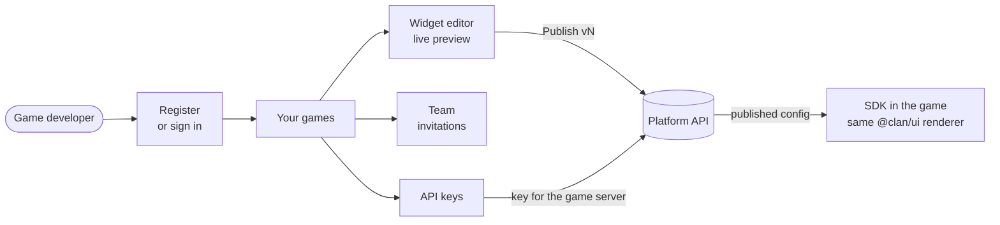

# clan-frontend

[](https://gitlab.com/clan-platform/clan-frontend/-/pipelines)


**Studio**, the dashboard of **Sociable**: game developers register their game, design its clans-and-chat widget
in a live editor, publish it, invite their team and create the API keys their game server needs. It also holds
the admin panel and the public developer guide (`/docs`).

Live at https://studio.130-61-158-79.sslip.io.



The widget preview and the game use the same renderer, `@clan/ui` (`packages/ui`), so what the developer sees in
the editor is what players get.

## Contents

- [Installation](#installation)
- [Usage](#usage)
- [Documentation](#documentation)
- [Contributing](#contributing)
- [Authors and contact](#authors-and-contact)
- [License](#license)

## Installation

You need [Node.js](https://nodejs.org/) 22 (LTS) and the backend running locally
([clan-backend](https://gitlab.com/clan-platform/clan-backend), `docker compose up --build`).

```sh
git clone https://gitlab.com/clan-platform/clan-frontend.git
cd clan-frontend
cp .env.example .env     # PowerShell: Copy-Item .env.example .env; set VITE_PLATFORM_URL
npm install
npm run dev              # http://localhost:5173
```

Keep port 5173: the local Platform service accepts browser calls from that address only.

## Usage

1. Open http://localhost:5173 and create a developer account.
2. **Register existing game**, then open **Customize widget**: change the layout, texts and style and watch the
   preview, then **Publish**.
3. Open **API keys** and create a key for the game's server. It is shown once.
4. Add the widget to the game with the SDK. The guide at http://localhost:5173/docs shows how, with copyable samples.

Other commands:

```sh
npm test                 # unit and component tests (Vitest)
npm run build            # production build into dist/
npm run preview          # serve that build
```

## Documentation

| Read | For |
|---|---|
| [docs/development.md](docs/development.md) | Running, environment variables, code layout, the API client, stylesheets |
| [docs/features.md](docs/features.md) | How each part works: frames and theme, sign-in and routes, games and keys, the guide, the widget editor, teams |
| [docs/deployment.md](docs/deployment.md) | CI, the Studio image, deploying, rolling back, publishing `@clan/ui` |
| [docs/config-v1/README.md](docs/config-v1/README.md) | The widget config: schema, limits, versioning |
| [packages/ui/README.md](packages/ui/README.md) | `@clan/ui`, the shared widget renderer |

## Contributing

- **Bugs and ideas:** open a ticket in the team's tracker (`TEAM-<number>`) or an issue in this project, with the
  steps to repeat it and a screenshot.
- **Branches:** start from `develop`, for example `fix/TEAM-123-editor-preview` or `feat/TEAM-124-clan-tags`.
- **Commits:** `type(scope): what changed (TEAM-123)`, where the type is `feat`, `fix`, `docs`, `refactor` or `test`.
- **Merge requests:** into `develop` (protected), with `npm test` and `npm run build` passing. Keep the layering in
  [docs/development.md](docs/development.md#layout): components call hooks, hooks call a feature's `api/`.
- **Releases:** `develop` is merged into `main`, and **every merge to `main` is deployed**. A change under
  `packages/ui` publishes a new `@clan/ui` from `develop`, which clan-sdk then picks up.

## Authors and contact

Built by the Sociable team at Xsolla School Baku:

- Murad Hasanli
- Nuray Mukhtarli
- Farida Shakikhanli

Questions and support: sociableplatform.support@gmail.com.

## License

No license has been chosen yet, so all rights are reserved by the authors.
